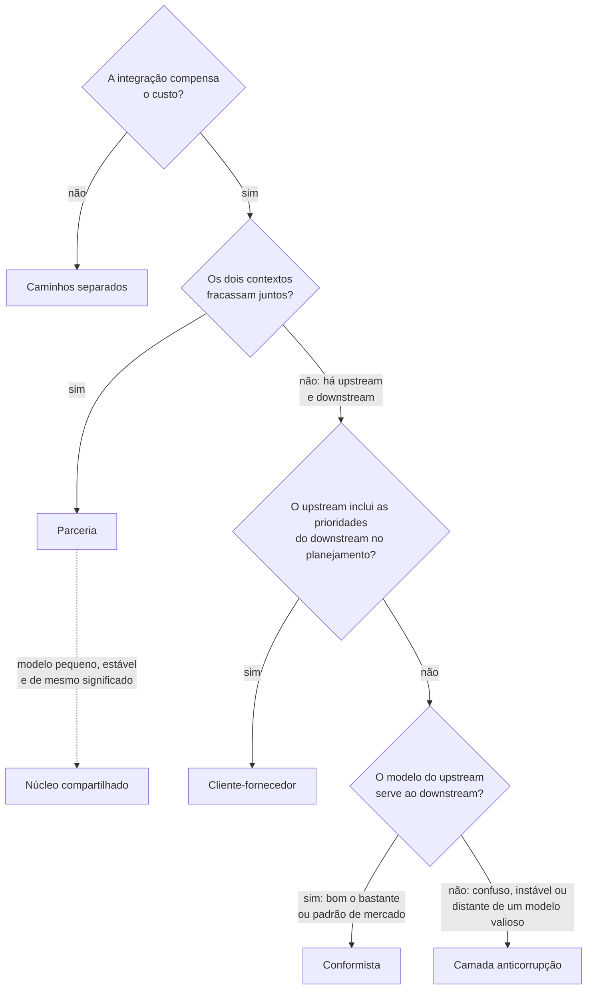
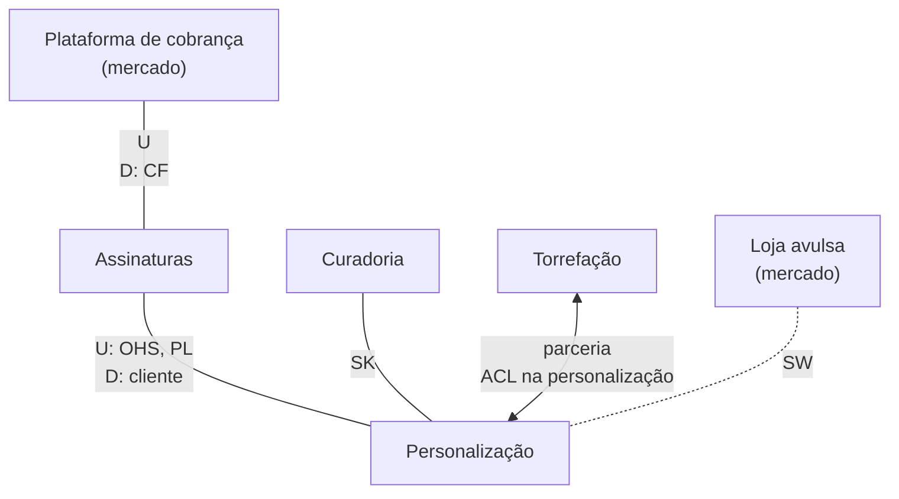
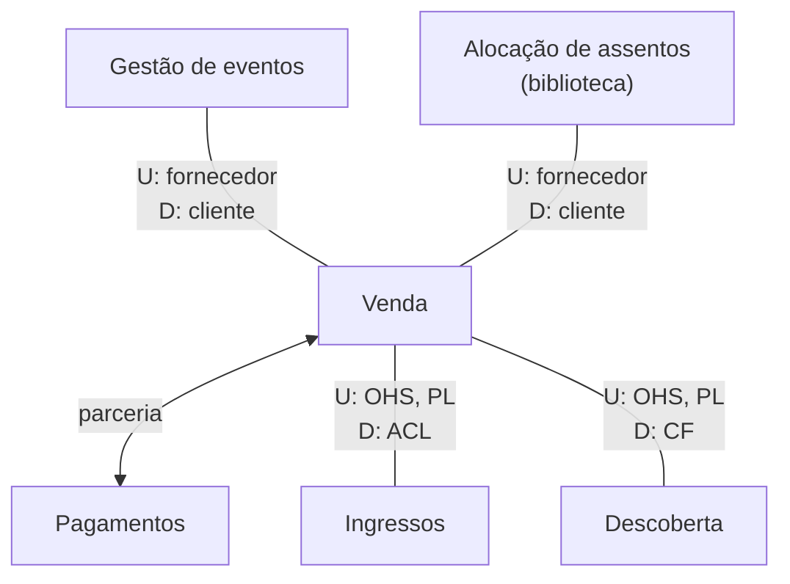
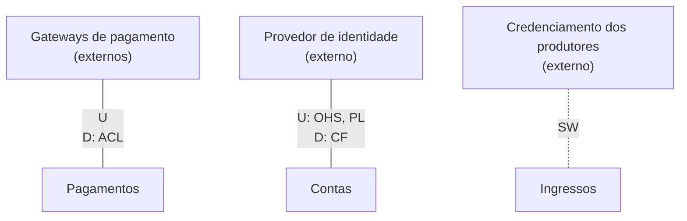

# Mapeamento de Contextos com DDD

Guia de referência rápida sobre **como contextos delimitados se relacionam e se integram**: direção da influência, relações entre times, padrões de mapeamento de contextos (parceria, núcleo compartilhado, cliente-fornecedor, conformista, camada anticorrupção, serviço de host aberto, linguagem publicada e caminhos separados), notação do mapa e sinais de risco, com um exercício resolvido e um exemplo aplicado.

> [!NOTE]
> Síntese pessoal de conceitos consolidados na literatura de *Domain-Driven Design*. As fontes estão nas [referências](#referências). Dá sequência ao guia [Design Estratégico com DDD](https://github.com/sidartaoss/design-estrategico-com-ddd) e complementa os guias [Fundamentos de Arquitetura de Software](https://github.com/sidartaoss/fundamentos-arquitetura-software), [Monolitos e Microsserviços](https://github.com/sidartaoss/monolitos-e-microsservicos), [Práticas e Tecnologias para Microsserviços](https://github.com/sidartaoss/praticas-e-tecnologias-para-microsservicos), [Custos e Riscos de Microsserviços](https://github.com/sidartaoss/custos-e-riscos-de-microsservicos), [Adoção de Microsserviços](https://github.com/sidartaoss/adocao-de-microsservicos), [Comunicação entre Microsserviços](https://github.com/sidartaoss/comunicacao-entre-microsservicos), [Fronteiras de Microsserviços](https://github.com/sidartaoss/fronteiras-de-microsservicos) e [Implementação de Microsserviços](https://github.com/sidartaoss/implementacao-de-microsservicos).

## Em resumo

- **Contextos delimitados não vivem isolados.** Cada ponto de contato é um contrato, com uma linguagem, um dono e uma direção de influência: o *upstream* afeta o *downstream*, e não o contrário.
- **A relação entre contextos é uma relação entre times.** Os times podem ser mutuamente dependentes, estar em uma relação *upstream-downstream* ou ser livres, e a estrutura da organização costuma impor os padrões.
- **Os padrões respondem a duas perguntas.** Parceria, núcleo compartilhado, cliente-fornecedor, conformista e caminhos separados dizem quem decide o contrato; camada anticorrupção, serviço de host aberto e linguagem publicada dizem onde acontece a tradução entre os modelos. Um relacionamento combina respostas às duas.
- **A tradução tem lugar certo.** O *upstream* com muitos consumidores publica uma interface estável, em uma linguagem própria para integração; o *downstream* com um modelo valioso traduz na própria borda. Conformar-se é legítimo quando o modelo de fora é bom o bastante.
- **Não integrar também é uma decisão.** Quando a integração custa mais do que a duplicação, cada contexto segue o próprio caminho, exceto onde as regras precisam ser consistentes.
- **O mapa descreve o terreno atual.** Mapeia-se o que existe antes de propor mudanças, em mapas pequenos, cada um para uma pergunta, revistos quando times e contratos mudam.

## 1. Pontos de contato entre contextos

Contextos bem delimitados continuam dependendo uns dos outros: a venda precisa das sessões e dos lotes definidos pela gestão de eventos, e o contexto de ingressos precisa saber que assento foi vendido e para quem. Cada ponto de contato é um **contrato**, seja uma API, um evento, um arquivo ou um acordo informal, e levanta três perguntas:

| Pergunta | Por que importa |
|---|---|
| Em que linguagem o contrato é expresso? | Cada contexto tem a sua linguagem ubíqua: a venda fala em comprador; o contexto de ingressos, em titular, que pode não ser quem comprou |
| Quem decide o contrato? | Um lado, os dois em conjunto ou cada um o seu |
| Quem depende de quem? | Quem sofre quando o contrato muda |

O **mapeamento de contextos** (*context mapping*) responde a essas perguntas: identifica os contextos delimitados de um sistema, inclusive os sistemas externos e legados com que ele se integra, e descreve as relações entre eles, nos planos técnico e organizacional. O **mapa de contextos** (*context map*) é o seu registro.

> "Descreva os pontos de contato entre os modelos, explicitando a tradução de toda comunicação e destacando o que é compartilhado, os mecanismos de isolamento e os níveis de influência." — Eric Evans

## 2. Upstream e downstream

O ***upstream*** (rio acima) é o contexto cujas decisões afetam o outro; o ***downstream*** (rio abaixo) é o que sente essas decisões. A relação é assimétrica: nas palavras de Evans, o time *upstream* pode ter sucesso independentemente do destino do time *downstream*; já uma mudança no *upstream* pode quebrar o *downstream*.

A direção é de **influência**, e não necessariamente de fluxo de dados. O contexto de pagamentos envia cobranças a um gateway: os dados vão de pagamentos para o gateway, mas é o modelo do gateway que se impõe, e pagamentos é o *downstream*. Por isso, no mapa, as letras U e D marcam os papéis, e setas de fluxo confundem mais do que ajudam.

## 3. Relações entre times

Cada contexto pertence a um único time, que pode cuidar de mais de um ([contextos delimitados](https://github.com/sidartaoss/design-estrategico-com-ddd#8-contextos-delimitados-e-linguagem-ubíqua)). Por isso, a relação entre dois contextos é também uma relação entre times, de três tipos, como os organiza a DDD Crew:

| Relação | O que a caracteriza | Padrões típicos | Exemplo: venda de ingressos |
|---|---|---|---|
| Mutuamente dependentes | Os dois precisam ser entregues juntos para funcionar; se um falha, o outro falha | Parceria; núcleo compartilhado | Venda e pagamentos: uma compra só se conclui com o pagamento aprovado, e não há cobrança sem pedido |
| *Upstream-downstream* | As ações de um afetam o outro, sem reciprocidade significativa | Cliente-fornecedor; conformista | Venda e ingressos: o contexto de ingressos depende do assento vendido, mas a venda não depende dele |
| Livres | Mudanças em um não afetam o sucesso do outro; não há vínculo técnico nem organizacional | Caminhos separados | Ingressos e os sistemas com que os produtores credenciam equipes e imprensa |

Vlad Khononov agrupa os padrões da mesma forma: cooperação (parceria e núcleo compartilhado), cliente-fornecedor (conformista, camada anticorrupção e serviço de host aberto) e caminhos separados. A relação raramente é escolhida no vazio: como observa Alberto Brandolini, na maioria das vezes a estrutura da organização impõe os padrões, na linha da [Lei de Conway](https://github.com/sidartaoss/monolitos-e-microsservicos#3-a-lei-de-conway). Há um paralelo com os modos de interação de [Team Topologies](https://github.com/sidartaoss/praticas-e-tecnologias-para-microsservicos#3-team-topologies): a cooperação lembra a colaboração, intensa e indicada por períodos definidos; um serviço de host aberto lembra o *X-as-a-Service*, com o mínimo de coordenação.

## 4. Quem decide o contrato: padrões de relação entre times

Os nomes em português acompanham a tradução pt-BR do repositório *Context Mapping*, da DDD Crew.

### Parceria (*Partnership*)

Para Evans, quando o fracasso de um dos contextos leva ao fracasso dos dois, os times devem firmar uma parceria: planejar o desenvolvimento de forma coordenada, gerir a integração em conjunto, evoluir as interfaces para atender aos dois lados e programar as funcionalidades interdependentes para a mesma entrega. Nenhum lado é dono do contrato.

- **Quando usar:** os contextos precisam ser separados, porque os modelos são distintos, mas a interdependência é inevitável, e os times têm compromisso real em colaborar. Brandolini é direto: tentar uma parceria sem um ambiente colaborativo é uma estratégia sem saída.
- **Custo:** agendas acopladas, alinhamento constante e entregas que travam quando um lado atrasa ou muda de rumo. Não é a escolha padrão: se a dependência puder ser reduzida, uma relação com menos coordenação tende a ser melhor.
- **Prática útil:** uma suíte de testes que prove que a interface atende ao lado que a consome, executada na integração contínua de quem a fornece.

### Núcleo compartilhado (*Shared Kernel*)

Os times delimitam, com uma fronteira explícita, um subconjunto do modelo de domínio que concordam em compartilhar, com o código e, se for o caso, o esquema de banco associados. Evans pede que esse núcleo seja **pequeno**, que não mude sem consulta ao outro time e que um processo de integração contínua o mantenha coeso.

- **Não é qualquer biblioteca comum.** Uma biblioteca de log ou de segurança é um componente técnico compartilhado; o núcleo contém conceitos e regras do domínio, com o mesmo significado nos dois contextos.
- **Quando vale:** quando duplicar o modelo custa mais do que coordenar as suas mudanças, critério que Khononov torna explícito. Funciona melhor com um modelo pequeno e estável, entre times que já são parceiros ou dentro de um mesmo time.
- **Riscos:** acoplamento técnico, *builds* quebrados do outro lado, perda de autonomia e, sobretudo, crescimento: o núcleo que acumula conceitos de um lado só vira um monolito compartilhado. Ajuda ter um único time guardião, que aceita contribuições por *pull request* (no GitHub, o arquivo `CODEOWNERS`, somado à proteção da *branch*, torna obrigatória a revisão do guardião), e executar os testes dos dois contextos a cada mudança.

A classe `Ingresso` única, rejeitada no [guia anterior](https://github.com/sidartaoss/design-estrategico-com-ddd#12-exemplo-aplicado-plataforma-de-venda-de-ingressos), mostra o limite: grande, instável e com um significado diferente em cada contexto, ela não seria um núcleo compartilhado, e sim uma bola de lama distribuída.

### Cliente-fornecedor (*Customer/Supplier Development*)

Em uma relação *upstream-downstream*, o *downstream* pode ficar à mercê das prioridades do *upstream*, e o *upstream*, inibido pelo medo de quebrar quem depende dele. A saída proposta por Evans é uma relação clara de cliente e fornecedor: as prioridades do *downstream* entram no planejamento do *upstream*, e as demandas são negociadas e orçadas, para que todos conheçam o compromisso e o prazo.

- **O *upstream* continua dono do modelo.** O *downstream* ganha voz, e não veto: um veto sobre as mudanças paralisaria o *upstream*.
- **Testes de aceitação conjuntos**, executados na integração contínua do *upstream*, permitem que ele mude sem medo de efeitos colaterais; uma forma atual dessa prática são os [contratos orientados ao consumidor](https://github.com/sidartaoss/comunicacao-entre-microsservicos#7-contratos-e-evolução), de Ian Robinson.
- **Sinais de ausência:** pedidos que nunca entram no planejamento, promessas informais e uma integração que vira fonte constante de atrito.

### Conformista (*Conformist*)

Quando o *upstream* não tem motivação para atender ao *downstream*, caso comum em plataformas de terceiros, em times com dezenas de consumidores e em relações de poder desequilibradas, o *downstream* pode eliminar a tradução adotando à risca o modelo do *upstream*. Evans reconhece que isso restringe o design do *downstream*, mas simplifica enormemente a integração e ainda dá aos dois uma linguagem comum.

- **Quando é aceitável:** o modelo de fora é bom o bastante, ou é um padrão de mercado, e o contexto que se conforma não é estratégico.
- **Risco:** os conceitos de fora se espalham pelo código do *downstream*, em mapeamentos e ajustes locais, até que o seu modelo perca a clareza. Um subdomínio principal não deve se conformar a um modelo que não controla.

### Caminhos separados (*Separate Ways*)

"A integração é sempre cara, e às vezes o benefício é pequeno", escreve Evans. Quando duas funcionalidades não têm relação significativa, os contextos podem ser desligados um do outro, sem API, eventos ou tradução, cada um com soluções simples e especializadas, mesmo que isso duplique algo. Khononov reúne os motivos em três: problemas de comunicação entre os times, funcionalidades genéricas que cada contexto resolve com um produto de mercado e modelos tão diferentes que traduzir custaria mais do que duplicar.

- **Quando evitar:** em subdomínios principais e onde os contextos precisam concordar sobre os mesmos fatos. Se a venda e o contexto de ingressos seguissem caminhos separados, um pedido cancelado e reembolsado continuaria com um ingresso válido na portaria.
- **No mapa:** a ausência de linha já indica que não há integração; uma linha tracejada com o rótulo de caminhos separados registra que a decisão foi consciente.

## 5. Onde a tradução acontece: camada anticorrupção, serviço de host aberto e linguagem publicada

Estes padrões não dizem quem decide o contrato, e sim como cada lado protege o próprio modelo; por isso, combinam com qualquer relação entre times.

### Camada anticorrupção (*Anticorruption Layer*)

É uma camada de isolamento, do lado do *downstream*, que, nas palavras de Evans, oferece a funcionalidade do *upstream* nos termos do modelo do *downstream*, conversa com o outro sistema pela interface que ele já tem e traduz nos dois sentidos, quando necessário. Ela não elimina o esforço de adaptação: concentra-o em um só lugar, onde as mudanças de fora são absorvidas.

- **Quando usar:** o modelo de fora é confuso, legado ou instável; ou é bem feito, mas distante de um modelo valioso, sobretudo o de um subdomínio principal; ou muda com tanta frequência que é preciso conter o impacto.
- **O que contém:** fachadas, adaptadores, tradutores e DTOs, e nenhuma regra de negócio nem orquestração, como reforça o padrão publicado pela Microsoft.
- **Onde fica:** em um pacote na borda do contexto ou em um serviço próprio, quando vários contextos precisam da mesma tradução ou o sistema externo exige protocolos que não se quer dentro do contexto. Um serviço acrescenta latência e mais um componente a operar.

No contexto de pagamentos, o gateway de cartão fala a própria língua, e a camada é o único lugar que a conhece:

```java
// Contexto de pagamentos: a porta fala a linguagem do contexto
public interface ProcessadorDeCartao {
    ResultadoDaCobranca cobrar(Cobranca cobranca);
}

// Camada anticorrupção: o único lugar que conhece o modelo do gateway
final class GatewayXAdapter implements ProcessadorDeCartao {

    private final GatewayXClient cliente;

    GatewayXAdapter(GatewayXClient cliente) {
        this.cliente = cliente;
    }

    @Override
    public ResultadoDaCobranca cobrar(Cobranca cobranca) {
        ChargeResponse resposta = cliente.createCharge(new ChargeRequest(
                cobranca.valor().emCentavos(), "BRL",
                cobranca.tokenDoCartao(), cobranca.chaveDeIdempotencia()));

        return switch (resposta.status()) {
            case "paid" -> ResultadoDaCobranca.aprovada(resposta.id());
            case "under_review" -> ResultadoDaCobranca.emAnalise(resposta.id());
            case "refused" -> ResultadoDaCobranca.recusada(motivo(resposta.refusalCode()));
            default -> throw new SituacaoDesconhecida(resposta.status());
        };
    }

    private static MotivoDaRecusa motivo(String codigo) {
        return switch (codigo) {
            case "insufficient_funds" -> MotivoDaRecusa.SALDO_INSUFICIENTE;
            case "suspected_fraud" -> MotivoDaRecusa.SUSPEITA_DE_FRAUDE;
            case "expired_card" -> MotivoDaRecusa.CARTAO_VENCIDO;
            default -> MotivoDaRecusa.OUTRO;
        };
    }
}
```

Os nomes em inglês são do gateway; os em português, do contexto. A camada só traduz: o que fazer com uma cobrança em análise é decisão do modelo de pagamentos, e uma situação desconhecida falha explicitamente, em vez de ser adivinhada. Trocar de gateway, ou acrescentar um segundo, exige uma nova implementação da porta, sem mudanças no restante do contexto.

### Serviço de host aberto e linguagem publicada (*Open-host Service* e *Published Language*)

Do outro lado da fronteira está o problema simétrico. Quando um contexto atende a muitos consumidores, escrever um tradutor para cada um sobrecarrega o time. Evans propõe definir um protocolo que dê acesso ao contexto como um conjunto de serviços e abri-lo a todos que precisem se integrar: o **serviço de host aberto**. O protocolo cresce com as novas necessidades de integração, exceto as idiossincráticas de um único time, atendidas por um tradutor à parte, para que o protocolo compartilhado continue simples e coerente. O fornecedor fica na posição *upstream*; entre os consumidores, alguns se conformam, e outros constroem camadas anticorrupção.

A **linguagem publicada** é o contrato desse serviço: uma linguagem bem documentada, capaz de expressar a informação de domínio necessária, de e para a qual cada lado traduz. Não é o modelo interno de nenhum dos lados: segundo Evans, um modelo interno usado como linguagem de troca fica congelado e deixa de acompanhar o desenvolvimento. Há linguagens publicadas de mercado, como iCalendar, vCard e OpenID Connect, e há as que cada organização cria, hoje descritas em OpenAPI ou AsyncAPI e versionadas em um registro de esquemas ([contratos](https://github.com/sidartaoss/comunicacao-entre-microsservicos#7-contratos-e-evolução)).

Nem toda API é um serviço de host aberto. Um *endpoint* que serializa a entidade de domínio, ou um evento que é cópia da classe interna, expõe o modelo, e qualquer refatoração vira quebra de contrato. O serviço de host aberto é uma interface pública deliberada, com linguagem e regras de evolução próprias.

| Abordagem | Quem traduz | Indicada quando |
|---|---|---|
| Conformista | Ninguém: o *downstream* adota o modelo do *upstream* | O modelo de fora é bom o bastante, e o contexto não é estratégico |
| Camada anticorrupção | O *downstream*, na própria borda | O modelo de fora é confuso, instável ou distante de um modelo valioso |
| Serviço de host aberto com linguagem publicada | O *upstream*, uma vez para todos | Há muitos consumidores, e o modelo interno precisa evoluir livremente |
| Linguagem publicada e camada anticorrupção | Os dois lados | A linguagem publicada ainda está longe do modelo do *downstream* |

## 6. Como escolher

A relação entre os times vem primeiro, porque muitas vezes é dada pela organização; a forma de traduzir vem depois.



Qualquer que seja a relação, dois ajustes se somam ao resultado: o *upstream* com vários consumidores oferece um serviço de host aberto com linguagem publicada, e o *downstream* com um modelo valioso traduz em uma camada anticorrupção, mesmo quando é ouvido. As relações também mudam com a organização: Khononov descreve parcerias que se tornam relações de cliente-fornecedor quando a comunicação entre os times se enfraquece, e relações de cliente-fornecedor que terminam em caminhos separados. O mapa precisa acompanhar essas mudanças.

## 7. O mapa de contextos

Não há notação oficial. O *cheat sheet* da DDD Crew e o Context Mapper, que descreve os contextos em uma linguagem textual, versionável com o código, e gera os diagramas, são referências comuns.

| Elemento | Notação usual | Leitura |
|---|---|---|
| *Upstream* e *downstream* | `U` e `D` nas pontas da linha | Direção da influência, e não do fluxo de dados |
| Parceria | Rótulo "parceria" ou setas nos dois sentidos | Contrato decidido em conjunto |
| Núcleo compartilhado | `SK` sobre a linha, ou os contextos sobrepostos | Parte do modelo mantida em conjunto |
| Cliente-fornecedor | Rótulo "cliente-fornecedor", com `U` e `D` | O *downstream* influencia o planejamento do *upstream* |
| Conformista | `CF` na ponta do *downstream* | O *downstream* adota o modelo do *upstream* |
| Camada anticorrupção | `ACL` na ponta do *downstream* | O *downstream* traduz na própria borda |
| Serviço de host aberto e linguagem publicada | `OHS` e `PL` na ponta do *upstream* | Interface pública, em linguagem própria para integração |
| Caminhos separados | Nenhuma linha, ou linha tracejada com `SW` | Decisão consciente de não integrar |
| Grande bola de lama | Contorno em torno do sistema, com o rótulo "grande bola de lama" | Sistema sem fronteiras internas: não se modela dentro dele, e evita-se que contamine os vizinhos |

**Práticas.**

- **Mapear o terreno existente.** "Mapeie o terreno existente; deixe as transformações para depois", recomenda Evans. O mapa do estado desejado é outro mapa.
- **Começar pelos times**, na dúvida, como sugere Brandolini, e tratar o desenho como investigação: as primeiras versões terão erros, e o mapa nunca é final.
- **Mapas pequenos para perguntas explícitas**, recomendação da DDD Crew: como o modelo de um contexto se propaga, quem influencia um time, onde estão as dependências externas. Um mapa único com tudo vira excesso de informação.
- **Legenda com os padrões usados**, porque nem todos os leitores conhecem os nomes.

**Sinais de risco.**

| Sinal no mapa | O que pode indicar | Resposta possível |
|---|---|---|
| Muitos *downstreams* conformistas a um *upstream* que não ouve ninguém | Modelo imposto; *upstream* como gargalo | Relação de cliente-fornecedor com os principais consumidores, ou serviço de host aberto com linguagem publicada |
| Subdomínio principal conformista a um modelo alheio | O modelo mais valioso contaminado por decisões de fora | Camada anticorrupção |
| Muitas parcerias e núcleos compartilhados | Fronteiras mal traçadas, ou times mal alinhados aos contextos | Rever as fronteiras ou a distribuição dos contextos entre os times |
| Núcleo compartilhado que só cresce | Monolito compartilhado em formação | Reduzir o núcleo e duplicar o que não tem o mesmo significado |
| Caminhos separados onde as regras precisam concordar | Resultados divergentes para o mesmo fato | Integrar, ou concentrar a regra em um único dono |
| Linha sem padrão definido | Relação que nunca foi discutida | Nomear a relação com os dois times |

## 8. Exercício: integrações do clube de assinatura de cafés especiais

O clube de assinatura do [exercício anterior](https://github.com/sidartaoss/design-estrategico-com-ddd#11-exercício-clube-de-assinatura-de-cafés-especiais) delimitou seus contextos: curadoria, personalização, assinaturas e torrefação, com produtos de mercado para cobrança, loja avulsa e entregas. Três times cuidam deles: **Paladar** (curadoria e personalização), **Assinaturas** e **Operações** (torrefação e expedição). Cinco situações pedem uma decisão:

1. **Perfil sensorial.** A curadoria registra, para cada microlote, um perfil sensorial: descritores de aroma e sabor, intensidades de acidez, doçura e corpo, e a pontuação. A personalização usa exatamente esse perfil para escolher os cafés de cada assinante. O vocabulário de descritores muda poucas vezes por ano.
2. **Ciclo mensal.** A cada mudança, assinaturas publica a própria entidade `Assinatura`, com o token do cartão, a situação da cobrança e quem paga, para três consumidores: personalização, expedição e atendimento. Cada ajuste interno quebra algum consumidor, e o time recebe pedidos de mudança dos três lados.
3. **Planejamento da torra.** A seleção do mês depende dos lotes que serão torrados, e o plano de torra depende dos volumes selecionados: se um lado atrasa, as caixas não saem. Os times Paladar e Operações replanejam juntos toda semana. Os dados da torrefação vêm do sistema de gestão de mercado que ela usa, que fala em SKU, ordem de produção e item de estoque.
4. **Cobrança recorrente.** Assinaturas usa uma plataforma de cobrança recorrente cujo modelo de clientes, planos, faturas e tentativas de cobrança atende bem às regras atuais. O fornecedor avisa as mudanças com antecedência e não aceita pedidos de clientes pequenos.
5. **Loja avulsa.** Surgiu a proposta de usar as compras da loja avulsa, que roda em uma plataforma de comércio eletrônico de mercado, para refinar o perfil de paladar dos assinantes. Só 4% dos assinantes compram na loja, cujos produtos são identificados por SKU, sem perfil sensorial.

**Para resolver.** Em cada situação, que relação existe entre os times, que padrões se aplicam e que riscos ficam? Como fica o mapa? O que mudaria se a loja avulsa passasse a responder por metade da receita?

<details>
<summary><strong>Uma proposta de solução</strong></summary>

| Situação | Relação | Padrões | Justificativa e riscos |
|---|---|---|---|
| 1. Perfil sensorial | Cooperação, dentro do mesmo time | Núcleo compartilhado | O perfil tem o mesmo significado nos dois contextos, é pequeno e estável, e um só time o mantém: duplicar custaria mais do que coordenar. Risco: o núcleo crescer com conceitos de um lado só, como o preço de compra do microlote ou as preferências do assinante; só o perfil sensorial entra nele |
| 2. Ciclo mensal | *Upstream-downstream*; cliente-fornecedor com a personalização | Serviço de host aberto e linguagem publicada em assinaturas | Em vez da entidade, assinaturas publica "ciclo aberto", com destinatário, endereço e plano, sem dados de pagamento, e as mudanças internas deixam de quebrar os consumidores. A personalização, subdomínio principal, tem prioridade nas demandas. Risco: a linguagem virar depósito de campos de um consumidor só; necessidades idiossincráticas ficam em tradutores à parte |
| 3. Planejamento da torra | Mutuamente dependentes, em times diferentes | Parceria entre Paladar e Operações; camada anticorrupção na personalização | A interdependência é real, e os times já planejam juntos. A personalização, principal, não deve falar em SKU e ordem de produção: a camada traduz os dados do sistema de gestão para "lote de torra disponível". Risco: o custo de coordenação; se os times se distanciarem, Operações pode publicar o plano de torra antes da seleção, e a relação vira cliente-fornecedor |
| 4. Cobrança recorrente | *Upstream-downstream*, sem influência | Conformista | O modelo da plataforma atende às regras, e assinaturas é de suporte, com design simples: traduzir não compensaria. Risco: trocar de plataforma ficaria caro. Os termos do fornecedor não passam de assinaturas, porque a linguagem publicada da situação 2 não os expõe |
| 5. Loja avulsa | Livres | Caminhos separados, registrados no mapa | Benefício pequeno (4% dos assinantes) e modelos distantes (SKU e perfil sensorial). Critério para revisitar: compras avulsas relevantes para a personalização |



**Mudança de cenário.** Com a loja avulsa respondendo por metade da receita, as compras avulsas passam a ser um sinal relevante de paladar. Os caminhos separados dão lugar a uma integração em que a plataforma da loja é *upstream* sem influência, e a personalização, subdomínio principal, consome os pedidos por meio de uma camada anticorrupção que traduz SKU em microlote e perfil sensorial.

</details>

## 9. Exemplo aplicado: plataforma de venda de ingressos

Os guias anteriores delimitaram os contextos da plataforma e decidiram que cada um mantém o próprio modelo de ingresso ([design estratégico](https://github.com/sidartaoss/design-estrategico-com-ddd#12-exemplo-aplicado-plataforma-de-venda-de-ingressos)). Seguindo a recomendação de mapas pequenos, as relações aparecem em dois mapas, cada um para uma pergunta.

**Como o modelo da venda chega aos demais contextos?**



| Relação | Times (*upstream* → *downstream*) | Padrões | Por quê |
|---|---|---|---|
| Gestão de eventos e venda | Descoberta → Compra | Cliente-fornecedor | Sessões, mapas de lugares, lotes e cotas definem o que pode ser vendido; necessidades da venda, como um novo tipo de lote, entram no planejamento do time Descoberta |
| Alocação de assentos e venda | Subsistema complicado → Compra | Cliente-fornecedor | A biblioteca tem modelo próprio (fileiras, contiguidade, qualidade dos lugares), e a venda escreve testes de aceitação com cenários da abertura das vendas, como grupos de lugares contíguos sob alta concorrência, executados no pipeline da biblioteca: um contexto delimitado não precisa ser um serviço |
| Venda e pagamentos | Compra | Parceria, sem núcleo compartilhado | Os dois fracassam juntos, e o mesmo time planeja as duas pontas; os contextos trocam só identificadores e valores, e a composição do preço fica na venda |
| Venda e ingressos | Compra → Pós-venda | Cliente-fornecedor; serviço de host aberto e linguagem publicada na venda; camada anticorrupção em ingressos | Ingressos, subdomínio principal, traduz o comprador da venda em titular, que pode não ser quem comprou, e mantém a própria linguagem; suas demandas têm prioridade no planejamento da venda |
| Venda e descoberta | Compra → Descoberta | Serviço de host aberto e linguagem publicada; conformista | O mapa de assentos só precisa saber se cada lugar está livre, retido ou vendido: a linguagem publicada já serve, e traduzir não acrescentaria nada |

**Onde a plataforma depende de terceiros?**



| Relação | Padrões | Por quê |
|---|---|---|
| Gateways e pagamentos | Camada anticorrupção em pagamentos | Cada gateway tem as próprias situações e códigos de recusa; traduzi-los em um só lugar preserva a linguagem de pagamentos e facilita trocar de gateway (seção 5) |
| Provedor de identidade e contas | Linguagem publicada de mercado (OpenID Connect); conformista | O padrão é estável e bem documentado, e a autenticação é genérica: adotá-lo como está é a opção mais barata |
| Credenciamento e ingressos | Caminhos separados | Equipes, imprensa e fornecedores entram com credenciais emitidas e validadas pelos sistemas de cada produtor; integrá-los exigiria traduzir um modelo por produtor, para um benefício pequeno. Critério para revisitar: produtores pedirem validação única na portaria |

O serviço de notificações fica fora dos dois mapas: é técnico, sem modelo de domínio próprio. O repasse aos produtores, ainda em planilhas, também não aparece; quando virar software, consumirá a mesma linguagem publicada da venda.

**A decisão: a venda publica uma linguagem publicada.** Ingressos, descoberta e, no futuro, o repasse consomem os fatos da venda, cujo modelo interno (retenções, alocação, pedidos) muda a cada nova regra da abertura das vendas.

| Opção | Ganha | Abre mão de |
|---|---|---|
| Publicar os eventos internos do modelo de reservas | Nenhum contrato a desenhar | Cada consumidor se acopla ao modelo interno, e uma refatoração da venda quebra ingressos, descoberta e o futuro repasse |
| Um contrato sob medida para cada consumidor | Cada um recebe exatamente o que precisa | O time de Compra mantém um tradutor por consumidor e vira gargalo a cada nova integração |
| **Serviço de host aberto com linguagem publicada** (escolhida) | Um contrato estável, documentado e versionado, desenhado para integração; o modelo interno evolui livremente | Desenhar e governar a linguagem; manter tradutores à parte para necessidades de um único consumidor, para que o contrato continue simples |

A linguagem publicada da venda nomeia fatos de negócio compartilhados entre contextos, como assento vendido e venda cancelada, e não transições internas de estado; seus esquemas ficam no registro de esquemas, com as regras de compatibilidade do guia de [comunicação](https://github.com/sidartaoss/comunicacao-entre-microsservicos#9-exemplo-aplicado-plataforma-de-venda-de-ingressos). Cada consumidor escolhe como recebê-la: a descoberta se conforma, e ingressos traduz. A decisão, com as alternativas descartadas e o critério para revisitá-la, deve ser registrada em um ADR.

## Referências

- Eric Evans — *Domain-Driven Design: Tackling Complexity in the Heart of Software* (Addison-Wesley, 2003), cap. 14; edição brasileira: *Domain-Driven Design: Atacando as Complexidades no Coração do Software* (Alta Books); [Domain-Driven Design Reference](https://www.domainlanguage.com/ddd/reference/) (2015)
- Vaughn Vernon — *Implementing Domain-Driven Design* (Addison-Wesley, 2013), cap. 3; edição brasileira: *Implementando Domain-Driven Design* (Alta Books, 2016)
- Vlad Khononov — *Learning Domain-Driven Design* (O'Reilly, 2021), caps. 4 e 11; edição brasileira: *Aprenda Domain-Driven Design* (Alta Books, 2024)
- DDD Crew — [Context Mapping](https://github.com/ddd-crew/context-mapping), com [tradução pt-BR](https://github.com/ddd-crew/context-mapping/blob/master/translations/pt-br/README.md)
- [Context Mapper](https://contextmapper.org/)
- Alberto Brandolini — [Strategic Domain Driven Design with Context Mapping](https://www.infoq.com/articles/ddd-contextmapping/) (InfoQ, 2009)
- Microsoft — [Anti-Corruption Layer pattern](https://learn.microsoft.com/en-us/azure/architecture/patterns/anti-corruption-layer) (Azure Architecture Center)
- Ian Robinson — [Consumer-Driven Contracts: A Service Evolution Pattern](https://martinfowler.com/articles/consumerDrivenContracts.html) (2006)
- Matthew Skelton e Manuel Pais — *Team Topologies* (IT Revolution, 2019)
- Melvin Conway — [How Do Committees Invent?](https://www.melconway.com/Home/Committees_Paper.html) (*Datamation*, 1968)
- [RFC 5545: iCalendar](https://www.rfc-editor.org/rfc/rfc5545) (2009) e [OpenID Connect Core 1.0](https://openid.net/specs/openid-connect-core-1_0.html)
